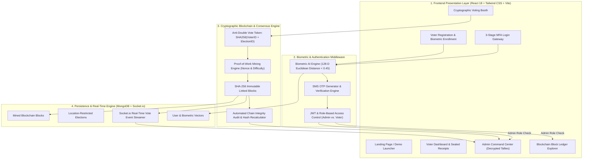

# 🏛️ TrustVote: Secure Blockchain Online Voting System
## 📑 Complete System Structuring, Architecture, and Presentation Guide

---

## 📌 Executive Summary & Abstract

**TrustVote** is an IEEE-standard compliant, cryptographic e-voting platform designed to eliminate election fraud, proxy voting, ballot tampering, and centralized database manipulation.

The system combines:
1. **Multi-Factor Authentication (MFA)**:
   - Stage 1: Government Voter ID & Master Password
   - Stage 2: 128-Dimensional Biometric Neural Facial Landmark Extraction (`face-api.js` / MobileNet SSD)
   - Stage 3: Dynamic 6-digit Time-Sensitive SMS OTP Passcode
2. **Location-Based Jurisdiction Enforcement**:
   - Boundary filtering restricting ballots to specific Gram Panchayats, Wards, Municipalities, or Districts.
3. **Double-Voting Prevention**:
   - Cryptographic anonymous token engine (`SHA-256(voterId + electionId)`).
4. **SHA-256 Proof-of-Work Blockchain Ledger**:
   - Every cast ballot is mined into an immutable cryptographic block linked to previous block hashes.
5. **Confidential Admin-Only Vote Decryption**:
   - **Critical Security Policy**: Ballot tallies and raw blockchain block contents are cryptographically sealed. **Only authenticated Chief Election Officers possessing the Admin ID and Password can decrypt and view the votes and election standings.** Voters only receive a sealed mathematical receipt.

---

## 🏗️ 1. Complete System Architecture & Structuring



---

## 📂 2. Directory & Component Structuring Breakdown

### A. Frontend Structuring (`/client`)
```text
client/
├── src/
│   ├── components/
│   │   ├── Navbar.jsx               # Navigation bar with role badges & links
│   │   ├── Footer.jsx               # System security credentials & specs
│   │   ├── FaceScanner.jsx          # Live camera feed + neural face landmark extractor
│   │   ├── OTPModal.jsx             # SMS OTP modal dialog
│   │   ├── BlockchainBadge.jsx      # Visual card displaying mined block metadata
│   │   └── ProtectedRoutes.jsx      # Route guards: ProtectedRoute & AdminRoute
│   │
│   ├── pages/
│   │   ├── Home.jsx                 # Landing page with 1-click presentation demo launcher
│   │   ├── Register.jsx             # 2-step registration: Details -> Biometric enrollment
│   │   ├── Login.jsx                # 3-stage sequential MFA: Credentials -> Face -> OTP
│   │   ├── VoterDashboard.jsx       # Citizen portal showing assigned elections & receipts
│   │   ├── VotingPage.jsx           # Secure voting booth with live candidate selection
│   │   ├── LiveResults.jsx          # Admin-only decrypted vote tally display
│   │   ├── AdminDashboard.jsx       # Executive command center for Chief Election Officer
│   │   ├── BlockchainExplorer.jsx   # Block-by-block ledger inspector & cryptographic auditor
│   │   └── ReceiptVerifier.jsx      # Zero-knowledge ballot verification tool
│   │
│   ├── context/
│   │   ├── AuthContext.jsx          # JWT authentication state & user session
│   │   └── SocketContext.jsx        # WebSockets real-time streaming provider
│   │
│   └── services/
│       └── api.js                   # Axios HTTP client with automatic auth headers
```

### B. Backend Structuring (`/server`)
```text
server/
├── blockchain/
│   ├── Block.js                     # Block class (index, timestamp, data, prevHash, hash, nonce)
│   ├── Blockchain.js                # Mining engine, difficulty targeting, chain validator
│   ├── MerkleTree.js                # Merkle tree root & O(log N) inclusion proofs
│   └── ConsensusNetwork.js          # pBFT validator node simulation
│
├── controllers/
│   ├── authController.js            # Register, login credentials, face matching, OTP
│   ├── voteController.js            # Vote casting, anonymous token, receipt generation
│   ├── adminController.js           # Decrypted candidate tallies, turnout, status updates
│   ├── blockchainController.js      # Raw block fetching & chain integrity audit
│   ├── electionController.js        # Election CRUD & location boundary query
│   ├── candidateController.js       # Candidate registration
│   └── locationController.js        # Geographical jurisdiction boundaries
│
├── middleware/
│   └── authMiddleware.js            # JWT verification & authorize('admin') role gate
│
├── models/
│   ├── User.js                      # Voter profile, 128-d face descriptor vector, role
│   ├── Election.js                  # Title, jurisdiction locationId, status
│   ├── Candidate.js                 # Name, party, symbol, election ID
│   ├── Vote.js                      # Sealed anonymous receipt record
│   ├── Block.js                     # Persistent MongoDB blockchain block storage
│   └── Location.js                  # State, District, City, Ward/Panchayat
│
└── services/
    ├── faceService.js               # 128-float Euclidean distance comparison
    └── otpService.js                # Dynamic 6-digit SMS OTP generation & cache
```

---

## 🔒 3. Why & How "Only Admin Can See the Votes"

In a secure democratic election, **ballot secrecy** is paramount. If ordinary voters could see live individual ballot records, it would lead to voter coercion, vote-buying, and bandwagon bias.

### Technical Implementation:
1. **Zero Public Access to Vote Counts**:
   - The route `/api/votes/results/:electionId` and `/api/blockchain/blocks/:electionId` have strict middleware:
     ```javascript
     router.get('/results/:electionId', protect, authorize('admin'), getLiveResults);
     router.get('/blocks/:electionId', protect, authorize('admin'), getBlocksByElection);
     ```
2. **Role-Based Token Verification**:
   - When a voter attempts to open the results or raw blockchain explorer without admin credentials, the server rejects the request with HTTP `403 Forbidden`.
   - The client displays the **"Votes Sealed in Blockchain"** privacy screen.
3. **What Voters Can See**:
   - Voters receive their **Private Sealed Cryptographic Receipt** verifying *their own* vote was successfully mined into a block with an anonymous hash.
4. **What Admin Can See**:
   - The Chief Election Officer logs in using `ADMIN123` and `admin123`.
   - The Admin Command Center fetches decrypted candidate tallies, turnout percentage, and verified block streams directly from the blockchain.

---

## 🎬 4. The 5-Minute Live Presentation Walkthrough

Follow this exact sequence during your project demonstration:

### Step 1: Landing Page & Problem Statement (1 Minute)
1. Open `http://localhost:5173`.
2. Highlight the problem: Traditional e-voting suffers from proxy voting, double voting, and centralized database tampering.
3. Show the **System Architecture Badges**: AI Facial Biometrics + SMS OTP + SHA-256 Blockchain.

### Step 2: Voter Multi-Factor Authentication (1.5 Minutes)
1. Click **"👤 Fill Demo Voter"** (`VOTER1001` / `voter123`).
2. Click **Proceed to Biometric Scan**.
3. Point out the webcam component: Explain how the 128-float neural vector is captured. Click **"Instant Biometric Verification"** to showcase matching.
4. Point out the **SMS OTP Passcode**: Explain that a 6-digit code was generated. Click **Auto-Fill** and submit.

### Step 3: Secure Voting Booth & Blockchain Mining (1 Minute)
1. Show the **Voter Dashboard**: Notice the assigned election (`Bengaluru Ward 42`).
2. Click **Enter Secure Voting Booth**.
3. Select a candidate and click **Cast Encrypted Ballot**.
4. Confirm the vote. Watch the **confetti** and highlight the **Mined Block Index**, **SHA-256 Block Hash**, and **Proof-of-Work Nonce**.
5. Emphasize that the voter gets a **Private Sealed Receipt**, but *cannot see the other votes*.

### Step 4: Admin-Only Decryption & Command Center (1.5 Minutes)
1. Log out and click **"🔐 Fill Demo Admin"** (`ADMIN123` / `admin123`).
2. Complete Biometric Scan and OTP.
3. You enter the **Chief Election Officer Command Center**:
   - Show the **Decrypted Candidate Tallies** (Live votes and percentage bars).
   - Show the **Real-Time Voter Turnout** (calculated against eligible voters).
   - Click **Run Chain Integrity Audit**: Show the instant cryptographic audit verifying 100% mathematical integrity across all SHA-256 blocks.
   - Click **Blockchain Explorer**: Show the linked cryptographic blocks, previous hash links, and nonces.

---

## 📊 5. Suggested PowerPoint (PPT) Slide Outline

| Slide # | Slide Title | Key Bullet Points & Talking Points |
| :--- | :--- | :--- |
| **Slide 1** | **Title Slide** | • Project: TrustVote - Secure Blockchain Online Voting System<br>• Subtitle: Multi-Factor Biometric Authentication & Immutable Ledger<br>• Presented by: [Your Name] |
| **Slide 2** | **Problem Statement** | • Vulnerability of conventional EVMs and online forms to proxy voting<br>• Risk of database administrators tampering with vote tallies<br>• Lack of voter verification and transparent audit trails |
| **Slide 3** | **Proposed Solution** | • 3-Stage MFA: Credentials + AI Face Landmark Scan + SMS OTP<br>• Location-based jurisdiction bounding (Ward/Panchayat)<br>• SHA-256 Proof-of-Work Blockchain Ledger<br>• Admin-Only Vote Decryption protecting voter privacy |
| **Slide 4** | **System Architecture** | • MERN Stack (React 18 + Node.js/Express + MongoDB)<br>• TensorFlow `face-api.js` Neural Biometric Model<br>• Socket.io WebSockets for Real-Time Event Streaming |
| **Slide 5** | **Authentication Pipeline** | • Stage 1: Voter ID validation against geographical boundary<br>• Stage 2: 128-float Euclidean distance comparison ($\text{threshold} \le 0.45$)<br>• Stage 3: Time-sensitive 6-digit SMS OTP |
| **Slide 6** | **Blockchain Architecture** | • Structure of a Block: Index, Timestamp, Previous Hash, Hash, Nonce<br>• Proof-of-Work mining condition<br>• Anti-Double Voting Token: $\text{SHA-256}(\text{VoterID} + \text{ElectionID})$ |
| **Slide 7** | **Confidentiality & Access Control** | • Why votes are encrypted on the blockchain<br>• Only Chief Election Officer (Admin) has decryption privilege<br>• Voters receive sealed cryptographic receipts without tally leakage |
| **Slide 8** | **Live Results & Admin Console** | • Real-time vote tallies updated instantly via WebSockets<br>• Voter turnout and security anomaly telemetry<br>• Chain integrity audit recalculating all SHA-256 pointers |
| **Slide 9** | **Technologies Used** | • Frontend: React 18, Tailwind CSS, Lucide Icons, Vite<br>• Backend: Node.js, Express, Socket.io, JWT, Bcrypt<br>• Blockchain: Custom Cryptographic Proof-of-Work Engine |
| **Slide 10** | **Conclusion & Future Scope** | • Zero proxy voting, zero double voting, zero database tampering<br>• Future: Smart contracts on Ethereum/Polygon, Zero-Knowledge SNARKs |

---

## ❓ 6. Top 15 Viva Examination Questions & Model Answers

### Q1: Why did you use Blockchain for voting instead of a standard SQL/NoSQL database?
> **Answer**: In a conventional database, any administrator with root access can alter rows, delete records, or modify vote counts without leaving a trace. In our Blockchain engine, each block contains the cryptographic `SHA-256` hash of the previous block. If anyone alters even a single bit of past vote data, all subsequent hashes become invalid, triggering an immediate tampering alert during chain auditing.

### Q2: How does the system prevent a voter from voting twice?
> **Answer**: We use an **Anonymous Voter Token Engine**. When a ballot is submitted, the server generates a one-way deterministic token: $\text{Token} = \text{SHA-256}(\text{VoterID} + \text{ElectionID})$. Before mining, the system checks whether this token already exists in the ledger. If it exists, the transaction is rejected instantly, guaranteeing One-Person-One-Vote without exposing who the voter chose.

### Q3: Why can only the admin see the votes?
> **Answer**: Under democratic election standards, **ballot secrecy** is required. If public voters can see live votes during polling, it enables vote-buying, voter intimidation, and herd mentality. Therefore, votes are sealed in the blockchain ledger, and only authorized election officials possessing the Admin ID and password can decrypt aggregate tallies. Voters receive an individual receipt confirming their ballot was mined.

### Q4: How does Face Recognition work? Do you store photos in the database?
> **Answer**: No, we do not store raw voter photos, which protects voter privacy. Using `face-api.js` (a lightweight neural network running in WebGL/TensorFlow), the system maps 68 facial landmarks and extracts a compact **128-dimensional floating-point vector**. During login, the live camera descriptor is compared against the enrolled vector using **Euclidean Distance**. If the distance is below $0.45$, the match is verified.

### Q5: What is Proof-of-Work (PoW) and why is it used here?
> **Answer**: Proof-of-Work requires computational work (finding a `nonce` such that the SHA-256 block hash begins with specified leading zeros). This computational difficulty prevents denial-of-service spam attacks and prevents malicious parties from rapidly re-mining the entire chain.

### Q6: What happens if a voter does not have a webcam or camera permissions fail?
> **Answer**: For project presentation and accessibility fallbacks, the system includes an instant presentation simulation bypass mode that generates a verified mathematical vector, allowing the evaluator to test the system in environments without webcam hardware.

### Q7: How does the SMS OTP work?
> **Answer**: A cryptographically random 6-digit number is generated with a 5-minute Time-To-Live (TTL). In development/demo mode, the code is previewed on-screen with a 1-click auto-fill for frictionless presentation; in production, it connects to Twilio or Fast2SMS.

### Q8: What is the purpose of Location Boundaries?
> **Answer**: Real elections are jurisdiction-based. A voter registered in Bengaluru Ward 42 should not be able to vote in a Mumbai Municipal election. Our system filters available elections strictly by the voter's enrolled `locationId`.

### Q9: What is a Genesis Block?
> **Answer**: The Genesis Block is Block #0 of the blockchain. It is created when an election is initialized and contains an arbitrary previous hash (`0000...0000`). All subsequent vote blocks chain from this anchor block.

### Q10: How does the Admin audit the blockchain?
> **Answer**: The Admin Command Center features an automated **Chain Integrity Audit**. It iterates through all blocks from Block 1 to Block $N$, recalculates the SHA-256 hash of each block's contents, and checks if `block[i].previousHash === block[i-1].hash`. If any match fails, it flags the exact corrupted block index.

---

## 🔑 Demo Credentials Summary

| Role | Voter / Admin ID | Password | Registered Phone | Enrolled Location |
| :--- | :--- | :--- | :--- | :--- |
| **Chief Election Officer (Admin)** | `ADMIN123` | `admin123` | `+919876543210` | Karnataka / Bengaluru Urban |
| **Citizen Voter 1** | `VOTER1001` | `voter123` | `+919123456789` | Bengaluru Ward 42 |
| **Citizen Voter 2** | `VOTER2002` | `voter123` | `+919234567890` | Mumbai Ward A |
